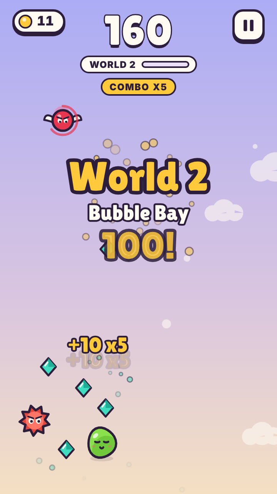

# Gloop Rush

A fast drag-to-dodge arcade game. Steer a jelly blob past spiky balls, chasers, cannons, lasers,
saws and mines, grab gems to travel through six worlds, and unlock skins.

<p align="center">
  
</p>

▶️ [Watch the gameplay video](media/gloop-rush-gameplay.mp4)

## What's in this repo

| Path | What it is |
|---|---|
| `www/index.html` | **The whole game** – one self-contained HTML file (no build step). |
| `index.html` | Redirects to the game, so GitHub Pages can host it. |
| `android/` | Android Studio project (Capacitor) that wraps the game as a Play Store app. |
| `assets/` | Source images for the app icon and splash screen. |
| `media/` | App icons, backgrounds, feature graphic, Play Store screenshots, gameplay video. |
| `capacitor.config.json` | App name and ID (`com.gloopgames.glooprush`). |

## Play it in a browser
Open `www/index.html` in any browser. Drag anywhere (or use arrow keys / WASD) to move.

### Host it free with GitHub Pages
Repo **Settings → Pages → Build and deployment → Deploy from a branch → `main` / root → Save**.
After a minute it's live at `https://<your-username>.github.io/<repo-name>/`.

> If you sell the app on Google Play, you may prefer to keep this repo **private** and skip Pages,
> so the full game isn't free online.

## Build the Android app
Needs [Node.js](https://nodejs.org) and [Android Studio](https://developer.android.com/studio).

```bash
npm install                # downloads Capacitor (required before Android Studio can build)
npx cap sync android       # copies www/ into the Android project
npx cap open android       # opens Android Studio
```

In Android Studio: **Build → Generate Signed App Bundle → Android App Bundle → release**.
Upload the resulting `android/app/release/app-release.aab` to the Play Console.

**Back up your keystore (`.jks`) and passwords somewhere safe – and never commit them.**
`.gitignore` already blocks them. You need the same key for every future update.

## Updating the game
1. Edit `www/index.html`.
2. `npx cap copy android`
3. Bump `versionCode` and `versionName` in `android/app/build.gradle`.
4. Build a new signed bundle and upload it.

## Tweaking gameplay
Key settings near the top of the `<script>` in `www/index.html`:

- `WORLDS` – colors and scenery for each world
- `GEMS_PER_WORLD` – gems needed to reach the next world (25)
- `SKINS` – skin colors, accessories and gem prices
- `DUR` – power-up durations in seconds (shield = 15)
- `REVIVE_COST` – gems to revive (25)

## License
© 2026 Gloop Rush. All rights reserved.
